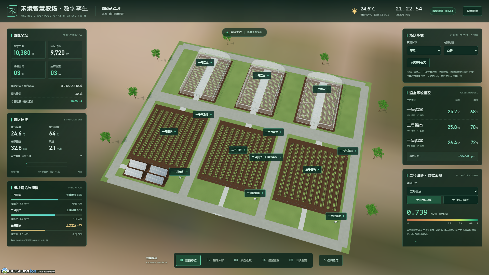

# 禾境智慧农场 · 农业数字孪生可视化平台

禾境智慧农场是一个面向农业园区的 Web 3D 可视化演示项目，使用 Vue 3、TypeScript、Three.js 和 Cesium 构建。项目将温室、露地田块、作物、太阳能板、气象站、土壤传感器及滴灌设施组织为可交互的三维场景，并通过监测面板展示环境、墒情、灌溉、NDVI 与告警信息。

当前版本为前端独立演示，监测数据由本地模拟源生成，无需后端或数据库。模拟情景、灌溉水流和环境预设用于展示，不代表真实设备采集、农事诊断或硬件控制。

## 功能特性

### 🌐 Cesium + Three.js 双引擎场景

- Cesium 承载本地栅格影像底图，Three.js 通过透明画布叠加农业模型。
- 以统一的米制 FarmWorld 坐标组织场景，同步相机视图矩阵、投影矩阵与画布尺寸。
- 使用 Cesium 驱动的统一帧调度更新和渲染，支持暂停、恢复及页面退出时资源释放。
- 地图使用椭球与影像，不加载 DEM 或真实地形；双画布各自管理深度。

### 🌱 农业园区与程序化模型

- 108 × 90 米示意园区，包含 3 座温室、3 块露地田、4 桌太阳能板及配套道路、树木和监测设施。
- 全园包含 10,380 株叶菜与 30 株番茄；每座温室 780 株叶菜、10 株番茄，每块露地田 2,680 株叶菜。
- 使用 Three.js 程序化构建叶菜、番茄、温室骨架与玻璃、树冠、太阳能板和滴灌管线等模型。
- 提供独立资产观察页，便于查看植物、温室、设备与田块细节。
- 采用实例化、静态几何合批、LOD 与更新缓存控制渲染开销，默认使用平衡画质档。

### 📊 园区监测与对象交互

- 展示空气温湿度、光照、风速、温室 CO₂、土壤湿度及灌溉流量和累计用水等模拟指标。
- 支持整园总览、棚内人眼、沿垄近景、温室全貌与田块全貌五种视角。
- 支持模型、标签和对象列表选择，高亮对象并联动详情面板，双击或点击按钮平滑聚焦。
- 当前接入 13 个可交互实体：3 块田、3 座温室、3 台气象站、3 个控制柜和 1 个土壤探头。
- 支持面板显隐、窄屏信息切换、返回总览及无 HUD 的 clean 展示模式。

### 💧 NDVI 与灌溉模拟

- 三块田分别维护 28 × 32 的演示 NDVI 数值栅格，通过 Shader 色带显示在地表、土垄和叶菜上。
- 支持自然材质与全田 NDVI 分析显示切换，展示当前田块栅格均值和本次会话趋势。
- 半透明管壁与管内 Shader 水流用于展示滴灌供水方向。
- 每块田可独立切换运行、待机、故障、数据缺失和数据过期情景，异常或过期数据不会伪装成正常读数。
- 基于有效模拟墒情生成提醒，支持从告警选择和定位对象。

### ☀️ 四季与光照预设

- 支持春、夏、秋、冬及白天、黄昏、夜晚的环境组合。
- 联动天空、雾、景观与照明表现；环境切换不改变模拟监测数据、作物状态或 NDVI 色带。
- 天空贴图由确定性程序生成，运行时加载工程内静态资源。

## 技术栈

| 层级 | 技术 | 用途 |
| --- | --- | --- |
| 前端框架 | Vue 3、TypeScript | 页面、交互与类型约束 |
| 构建工具 | Vite | 开发服务器与生产构建 |
| 三维图形 | Three.js 0.170 | 程序化建模、材质、实例化与交互 |
| 地理可视化 | Cesium 1.121 | 栅格影像与地理坐标适配 |
| 状态管理 | Pinia | 监测快照与 UI 状态投影 |
| 路由 | Vue Router | 园区、资产观察页与诊断入口 |
| 包管理 | pnpm 10.33.4 | 锁定依赖与可复现安装 |

## 项目结构

```text
agri-digital-twin-v2/
├── images/                      # README 项目效果图
├── public/
│   ├── maps/                    # 离线影像与地理范围清单
│   ├── environment/             # 程序化天空贴图
│   └── favicon.svg
├── scripts/
│   ├── prepare-cesium.mjs       # 从依赖准备 Cesium 静态资源
│   ├── prepare-imagery.py       # 可选：转换源影像
│   └── bake-daylight-clouds.py  # 可选：生成天空贴图
├── src/
│   ├── app/
│   │   ├── composition/        # FarmRuntime 与统一帧调度
│   │   └── ports/              # 场景、交互、环境和数据表现接口
│   ├── config/                 # 地理原点、园区布局、镜头及对象绑定
│   ├── data/                   # 模拟监测、告警与 NDVI 栅格
│   ├── rendering/
│   │   └── assets/             # 程序化模型、材质、合批与 LOD
│   ├── spatial/                # 坐标框架、地理转换与空间查询
│   ├── shared/                 # 空间数据契约
│   ├── ui/                     # Vue 页面、HUD 与状态管理
│   └── main.ts
├── index.html
├── package.json
├── pnpm-lock.yaml
├── tsconfig.json
└── vite.config.ts
```

发布仓库保留源码、运行资源与依赖清单，不包含本地测试、验收报告、编程规范、docs、node_modules 或构建产物。Cesium 的 `public/cesium/` 由启动或构建脚本自动生成。

## 快速开始

### 环境要求

- Node.js 22 LTS
- pnpm 10.33.4
- 支持 WebGL 2 的桌面浏览器，建议使用近期 Chrome 或 Edge

### 1. 获取项目并安装依赖

```bash
git clone https://github.com/11230614/agri-digital-twin-v2.git
cd agri-digital-twin-v2
npm install -g pnpm@10.33.4
pnpm install --frozen-lockfile
```

仓库内提供离线影像和天空贴图，正常启动不需要 Python、原始 TIFF、Cesium ion Token 或外部地图服务。

### 2. 启动开发服务

```bash
pnpm dev
```

浏览器访问 [http://127.0.0.1:5176/](http://127.0.0.1:5176/)，默认进入园区监测页面。开发端口固定为 5176，启动前请确保端口空闲。

### 3. 类型检查与生产构建

```bash
pnpm typecheck
pnpm build
pnpm preview
```

生产文件输出至 `dist/`，预览地址以终端输出为准。部署时应发布完整 `dist/`，包含生成的 Cesium Workers、Assets、Widgets 等资源。

当前资源 URL 使用 `/maps/`、`/environment/` 和 `/cesium/` 等根路径，适合部署到站点根目录。部署至 GitHub Pages 的仓库子路径时，需要先统一调整 Vite base 及运行资源路径。

## 页面与操作

| 入口 | 内容 |
| --- | --- |
| `/#/samples/park` | 园区监测主页面 |
| `/#/samples/greenhouse` | 温室与棚内作物 |
| `/#/samples/field` | 单田与滴灌设施 |
| `/#/samples/leaf`、`/#/samples/tomato` | 叶菜与番茄 |
| `/#/samples/tree`、`/#/samples/solar` | 树木与太阳能板 |
| `/#/samples/instruments`、`/#/samples/utilities` | 监测设备、控制柜与管线 |
| `/#/calibration`、`/#/diagnostics/park` | 双引擎校准与园区诊断 |

园区主页面操作：

- 左键拖动平移，右键拖动旋转和调整俯仰，滚轮缩放。
- 单击模型、标签或列表选择对象，双击模型/标签或使用“聚焦观察”靠近对象。
- 底部按钮切换五个预设视角，“返回总览”恢复整园观察。
- 右侧切换季节、光照时段、监测田块、NDVI 显示及模拟情景。

无界面展示：[http://127.0.0.1:5176/#/samples/park?clean=1](http://127.0.0.1:5176/#/samples/park?clean=1)。参数放在 hash 路由后；`quality=reference` 可切换参考画质，默认是 `balanced`。

## 核心运行流程

### 场景与渲染

```text
Vue 页面创建 FarmRuntime
  → 加载本地影像与程序化农业场景
  → 注册园区实体、交互目标和镜头
  → Cesium 驱动统一帧调度
  → 同步 Three.js 相机矩阵并渲染透明叠加层
  → 发布场景快照供 HUD 展示
  → 页面卸载时取消订阅并释放资源
```

### 模拟监测与数据表现

```text
DemoMonitoringSource 生成各田块与温室模拟观测
  → 派生墒情告警、NDVI 栅格均值与历史
  → Runtime 更新数据表现并发布快照
  → Pinia / HUD 展示指标、趋势与提醒
  → 用户经 SceneFacade 选择、聚焦或切换演示情景
```

控制柜和土壤探头展示关联田块的汇总数据，气象站展示园区气象汇总；这些值不代表各设备的独立遥测。情景切换改变本地模拟源，不发送真实控制指令。

## 数据与运行说明

- 周边底图来自用户提供的 Sentinel-2 L2A / Copernicus 真彩色影像，采集日期为 2026-11-06；地理范围、来源标注及转换信息保存在 `public/maps/imagery.json`。
- 农场为示意布局，地理原点及周边影像不构成实测农场控制点或测绘成果。NDVI 使用合成数值栅格，并非由真彩色底图反演。
- 当前没有业务后端、数据库或真实 IoT 接入。会话趋势与模拟状态不会跨刷新持久保存。
- 模型样板、园区交互和局部功能验证不等同于全部阶段验收完成；作物风动、完整设备动画与全场景性能仍需继续完善和验证。
- 性能随 GPU、分辨率、镜头与环境设置变化。参考画质用于对照，低性能设备建议使用默认平衡档。

## 许可证

本项目用于农业数字孪生的学习、开发演示与技术实践，目前未指定开源许可证。使用、转载或分发前请联系维护者确认授权，并遵守 Cesium、Three.js 等依赖及 Copernicus 影像的适用许可与署名要求。
